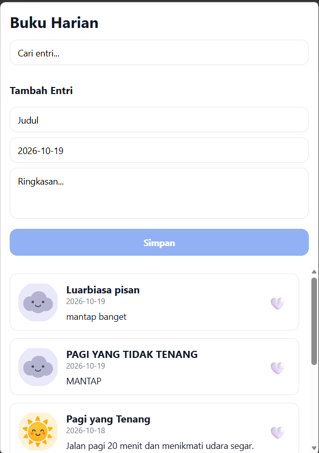
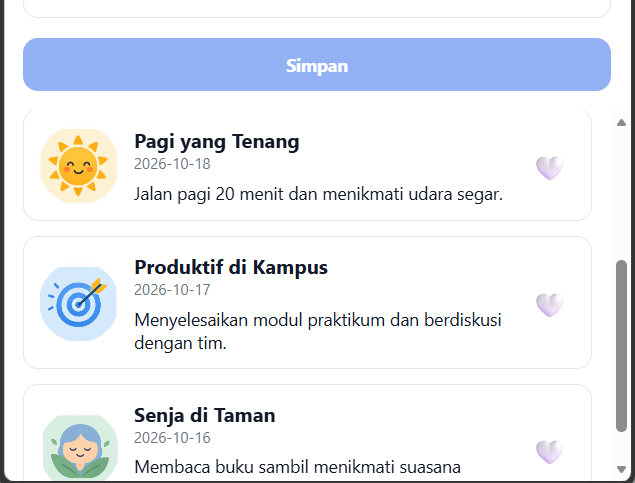

# Diary App — Praktikum Pemrograman Mobile

## Identitas Mahasiswa

- **Nama:** Awamirillah Qornaini
- **NIM:** 2430511004
- **Program Studi:** Teknik Informatika
- **Mata Kuliah:** Pemrograman Mobile

## Deskripsi Aplikasi

Diary App merupakan aplikasi buku harian sederhana yang dikembangkan menggunakan React Native dan Expo. Aplikasi ini menampilkan kumpulan catatan harian yang dilengkapi tanggal, ringkasan aktivitas, gambar, dan kategori suasana hati (*mood*).

## Fitur Aplikasi

- Menampilkan lima entri diary.
- Menampilkan avatar pengguna.
- Menampilkan judul, tanggal, dan ringkasan catatan harian.
- Menampilkan kategori mood pada setiap entri.
- Menggunakan warna kartu yang berbeda berdasarkan mood.
- Menggunakan gambar mood lokal `happy.png`.
- Menggunakan komponen `DiaryCard` yang dapat digunakan kembali (*reusable component*).
- Menggunakan `ScrollView`, `View`, `Text`, `Image`, dan `StyleSheet`.
- Menggunakan Flexbox untuk mengatur tata letak antarmuka.

## Teknologi yang Digunakan

- React Native
- Expo
- JavaScript
- Visual Studio Code
- Git dan GitHub

## Struktur Folder

```text
diary-app/
├── assets/
│   ├── moods/
│   │   └── happy.png
│   └── ...
├── screenshots/
│   └── diary-app.png
├── src/
│   ├── components/
│   │   └── DiaryCard.js
│   └── screens/
│       └── DiaryListScreen.js
├── App.js
├── app.json
├── index.js
├── package.json
└── README.md
```

## Cara Menjalankan Aplikasi

1. Pastikan Node.js sudah terpasang.
2. Clone repository GitHub atau buka folder proyek `diary-app`.
3. Buka terminal di folder proyek.
4. Instal dependensi dengan perintah:

   ```bash
   npm install
   ```

5. Jalankan aplikasi melalui browser menggunakan:

   ```bash
   npx expo start --web
   ```

6. Buka alamat localhost yang ditampilkan pada terminal.

## Screenshot Aplikasi

### Aplikasi 1



### Aplikasi 2




## Kesimpulan

Melalui praktikum ini, mahasiswa mempelajari dasar pengembangan antarmuka aplikasi menggunakan React Native dan Expo, penggunaan komponen dasar, pengaturan tata letak dengan Flexbox, pengelolaan aset gambar, serta penerapan reusable component untuk membuat kode lebih terstruktur.

---

